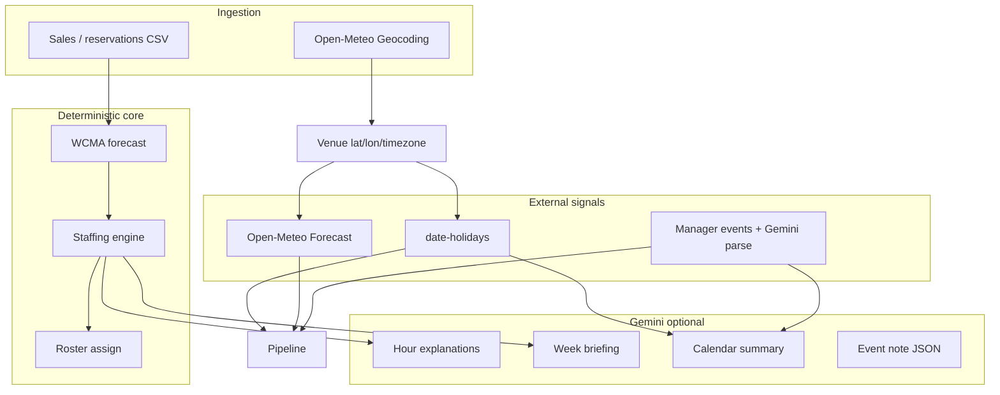

# External signals, forecast math, and Gemini

Reference for demos and judging: what talks to what, and where AI is (and is not) used.

## Architecture (one pass)

---

## Weather — Open-Meteo Forecast API

| Item | Detail |
|------|--------|
| **Library** | None (native `fetch`) |
| **API** | [Open-Meteo Forecast](https://open-meteo.com/en/docs) `GET /v1/forecast` |
| **Code** | `src/server/features/signals.ts` → `syncWeather()` |
| **When it runs** | Every `runPipeline()` / `ensurePipeline()`; daily cron `GET /api/cron/sync-weather` (Vercel `vercel.json`) |
| **Inputs** | Venue `latitude`, `longitude`, `timezone` (from signup geocoding) |
| **Fields used** | Hourly `precipitation`, `weather_code`, `temperature_2m` |
| **Method** | Rule-based impact, not ML |

**Rules (`weatherLabel`):**

- Heavy rain / code ≥ 61 → label **Rain**, multiplier **0.84**
- Light rain → **Light rain**, **0.93**
- Clear hours → no weather row (no adjustment)

Signals are stored as `external_signals` with `kind: "weather"`, one hour each. During forecast, `activeSignals()` picks signals overlapping each service hour; multipliers stack with holidays and events (clamped 0.55–2.0 in `pipeline.ts`).

**Use case:** Softening walk-in demand when patio or delivery-heavy service would drop on rainy hours.

---

## Local / public events — `date-holidays` + manager entry

### Public holidays

| Item | Detail |
|------|--------|
| **Library** | [`date-holidays`](https://www.npmjs.com/package/date-holidays) |
| **Code** | `syncHolidays()` in `src/server/features/signals.ts` |
| **Input** | Venue `countryCode` (ISO from signup) |
| **Method** | For each day in the forecast window, `holidays.isHoliday(noon local)`; keep **public** holidays only |
| **Impact** | Full local day, multiplier **1.22**, label = holiday name |

**Use case:** Diwali, bank holidays, etc. lift baseline covers without manual entry.

### Private / local events (manager)

| Item | Detail |
|------|--------|
| **UI** | `/events` → form or free-text **note** |
| **API** | `POST /api/events` |
| **Deterministic path** | Title + datetime + party size + impact multiplier |
| **AI path** | `parseEventNote()` → Gemini JSON extract; fallback regex/time parser |
| **Code** | `src/server/ai/parse-event.ts` |
| **After save** | `replan()` recomputes forecasts, recommendations, alerts |

**Use case:** “Wedding 80 Saturday 8pm” → structured event → raises demand multiplier for that window.

Weather rows are **not** listed on the Events page UI; holidays and manager events are.

---

## Venue placement — Open-Meteo Geocoding

| Item | Detail |
|------|--------|
| **API** | [Open-Meteo Geocoding](https://open-meteo.com/en/docs/geocoding-api) |
| **Code** | `placeCity()` in `src/server/auth/provision.ts` |
| **Use case** | Signup city → lat/lon + IANA timezone for WCMA buckets and weather |

---

## Demand forecast — WCMA (no AI)

| Item | Detail |
|------|--------|
| **Code** | `src/server/forecast/wcma.ts` |
| **Method** | Weighted cyclical moving average: same **weekday + hour** over last ~8 weeks, recent weeks weighted higher |
| **Outputs** | Predicted covers/orders per hour + confidence band |
| **Adjustments** | Product of weather × holiday × event multipliers; floor from reservations |

Headcount = `ceil(predicted_demand / covers_per_staff_hour)` per role (`src/server/staffing/engine.ts`).

---

## Gemini — Google Generative Language API

| Item | Detail |
|------|--------|
| **Env** | `GEMINI_API_KEY` |
| **Client** | `src/server/ai/gemini.ts` — REST `generateContent`, models `gemini-3-flash-preview`, fallbacks |
| **Safety** | Rate limit 20/min; 8s timeout; **never** used to compute headcount |

| Feature | Endpoint / UI | Role |
|---------|----------------|------|
| **Hour explanation** | `POST /api/ai/explain`, Staffing matrix cell | 2–3 sentences from structured drivers |
| **Week briefing** | `GET /api/ai/briefing`, Dashboard | Manager summary of peak, gaps, signals |
| **Calendar summary** | `GET /api/ai/signals-brief`, Events page | Holidays + manager events in prose |
| **Event note parse** | `POST /api/events` with `note` | JSON: title, times, party size, impact |

All features **template-fallback** if the key is missing or the API errors.

---

## Human in the loop

- **Approvals** (`/recommendations`): accept / ignore / edit required count — stored on the recommendation, not sent back through Gemini.
- **Roles / team / roster rebuild**: change inputs → pipeline runs again with same rules.

---

## Cron (production)

| Schedule | Route | Action |
|----------|--------|--------|
| `0 6 * * *` | `/api/cron/sync-weather` | Refresh Open-Meteo signals for all venues |
| `15 2 * * *` | `/api/cron/forecast-nightly` | `replan()` all venues |

Protected by `Authorization: Bearer $CRON_SECRET` in production.
